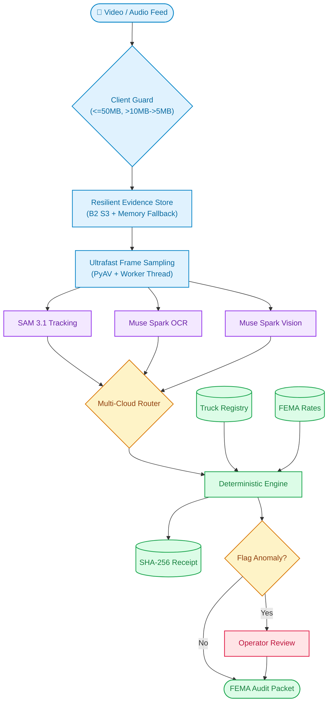
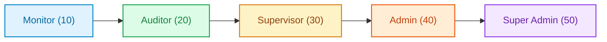
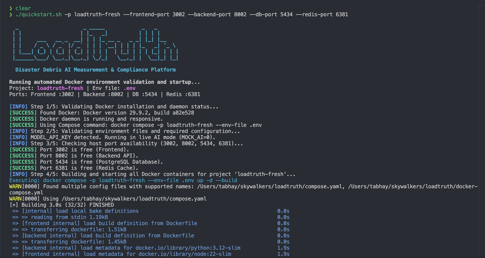

<div align="center">

<a href="https://youtu.be/ilH6tjTAGKs">
  
</a>

<p>
  <a href="https://youtu.be/ilH6tjTAGKs">YouTube Demo</a> ·
  <a href="https://github.com/Skywalkers-24/LoadTruth/releases/download/v1.0.0/LoadTruth_Demo.mp4">Backup Demo Video (MP4)</a> ·
  <a href="https://loadtruth.tiwabhay800.workers.dev/">Live Site</a> ·
  <a href="https://x.com/TAbhay_/status/2117253574615060641">X Post</a>
</p>

<br/>
<br/>

<picture>
  <source media="(prefers-color-scheme: dark)" srcset="docs/brand/dark/svg/loadtruth-dark-128.svg">
  <source media="(prefers-color-scheme: light)" srcset="docs/brand/light/svg/loadtruth-light-128.svg">
  
</picture>

# LoadTruth

### Precision load intelligence for disaster debris removal.

**Vision Measurement · Voice Transcription · Multi-Provider Inference · Cryptographic Receipts**  

[](https://github.com/Skywalkers-24/LoadTruth/actions/workflows/ci.yml)
[](tests/)
[](eval/RESULTS.md)
[](https://baseten.co)
[](https://modal.com)
[](https://fireworks.ai)
[](https://dev.meta.ai)
[](LICENSE)

---

## 🏛️ Meta Global AI Developer Hackathon 2026: Submission Overview

| Pillar / Criterion | Details |
|---|---|
| **Track & Category** | **Track 1: Build for Your World** · Civic Tech, Infrastructure & Sustainability |
| **Hackathon Provenance** | Built 100% from scratch during the hackathon window (October 26 – November 4, 2026). First commit: Oct 26. |
| **Working Live App** | [https://loadtruth.tiwabhay800.workers.dev/](https://loadtruth.tiwabhay800.workers.dev/) *(Live production deployment with pre-seeded demo tickets & zero OAuth barriers)* |
| **3-Minute Demo Video** | [https://youtu.be/ilH6tjTAGKs](https://youtu.be/ilH6tjTAGKs) *(3:00 stopwatch compliant with live UI footage, telemetry, and narration)*<br>• **Permanent Backup (Release Asset):** [LoadTruth_Demo.mp4](https://github.com/Skywalkers-24/LoadTruth/releases/download/v1.0.0/LoadTruth_Demo.mp4)<br>• **In-Repo Mirror:** [`demo/LoadTruth_Demo.mp4`](demo/LoadTruth_Demo.mp4) |
| **Meta AI Models & Partners** | • `SAM 3.1` (`api.meta.ai`): truck bed, load boundary & tailgate reference plane vector segmentation<br>• `Muse Spark 1.3` (`api.meta.ai`): multi-frame volumetric reasoning, placard OCR & debris material classification<br>• `Muse Voice Transcribe` (`api.meta.ai`): tower monitor radio transmission speech-to-text extraction<br>• `Muse Spark Open` / `Muse Glimmer` (`meta-models/muse-spark-open-1026`): load-bearing private/offline inference via **Baseten**, **Modal**, and **Fireworks AI** |

---

</div>

> **The Core Thesis:**  
> Every disaster debris load ticket is a quantity that nobody can independently reproduce. LoadTruth makes it a quantity anyone can reproduce, from the source video, in one click.

---

## 📌 Executive Summary

After a major hurricane or disaster, millions of tons of debris are hauled away and billed by the **cubic yard (CY)**. At temporary disposal sites, a short-term contractor known as a "tower monitor" stands on an elevated scaffold and eyeballs each passing dump truck, jotting down a rough fill percentage (often in arbitrary 10% steps). That single subjective guess becomes the legal load ticket that releases millions of taxpayer dollars—and is audited years later after the debris is buried and the trucks are gone.

**LoadTruth points a camera and microphone at the inspection lane.**
1. **SAM 3.1** tracks the truck bed, load surface, and tailgate reference plane, generating vectorized SVG mask evidence.
2. **Muse Spark** performs multi-frame visual fill percentage estimation, placard OCR, and debris material classification.
3. **Muse Voice Transcribe** captures the monitor's live radio call, strictly extracting stated fill percentages and spoken field warnings.
4. **Deterministic Code Decides**: Median frame aggregation, certified registry matching, compliance anomaly rules, and exact Python `Decimal` money math ensure models never hallucinate dollars or volumes.
5. **Cryptographic Evidence Receipt**: Generates a tamper-proof SHA-256 fingerprint over all raw inputs, allowing any county auditor, state FEMA inspector, or contractor to re-verify the exact measurement in sub-second time without an external AI call.

---

## 🧩 The Multi-Billion Dollar Reality

The disaster debris industry is massive, manual, and plagued by systemic billing disputes and federal fraud investigations:

<div align="center">

| Hard Metric | Primary Source | Operational Impact |
|---|---|---|
| **~107 Million CY** | [FEMA 2024 Season Report](https://www.fema.gov/press-release/20250926/recovery-continues-after-historic-2024-hurricane-season) | Total debris removed in a single year across disaster zones |
| **$190,070,000** | [Miami-Dade County 5-Yr Contract](https://www.miamidade.gov/govaction/legistarfiles/Matters/Y2026/261096.pdf) | The cost to pay human *monitors* alone in a single county |
| **500%+ Overbill** | [DHS Office of Inspector General](https://www.oig.dhs.gov/sites/default/files/assets/GrantReports/OIG_DD-09-04_Jan09.pdf) | Trucks documented billing at 5× their physical bed capacity |
| **$716,000 Fraud** | [U.S. Department of Justice](https://www.justice.gov/usao-edla/pr/two-sentenced-conspiracy-defraud-fema) | Criminal convictions for phantom truck runs and falsified tickets |
| **15M+ CY** | [FEMA Hurricane Sandy Fact Sheet](https://news.va.gov/wp-content/uploads/sites/3/2013/10/FEMA-Sandy-One-Year-Fact-Sheet.pdf) | Submerged coastal debris requiring urgent multi-agency accounting |

</div>

---

## 📐 Geometric Volume Derivation & Rigid Plane Calibration

A common question in computer vision is: *How can 2D video frames reliably measure 3D volume?*

**LoadTruth does NOT ask an AI model to guess 3D cubic yards out of thin air.** Instead, it binds zero-shot spatial perception to pre-certified physical constraints:

1. **Pre-Certified Truck Registry**: During mobilization, every hauling vehicle is physically measured (length × width × height) by county engineers to certify its maximum bed capacity in Cubic Yards ($V_{\text{certified}}$).
2. **SAM 3.1 Rigid Reference Plane**: SAM 3.1 tracks the rigid **tailgate top rim** and **bed sidewalls**. This defines the reference opening plane regardless of camera perspective or vehicle tilt.
3. **Contoured Load Tracking**: SAM 3.1 tracks the debris surface across video frames. The fill ratio is computed per frame:
   $$\text{Fill Ratio}_i = \frac{\text{Pixel Area}(\text{Load Surface}_i)}{\text{Pixel Area}(\text{Bed Opening}_i)}$$
4. **Deterministic Median Volume Derivation**:
   - **Estimated Volume**:
     $$V_{\text{estimated}} = V_{\text{certified}} \times \text{Median}(\text{Fill Ratio}_{1..N})$$
   - **Load Valuation**:
     $$\text{Load Valuation (USD)} = V_{\text{estimated}} \times \text{Contract Rate Table (USD / CY)}$$

No generative model ever invents volume or dollar amounts. Models provide pure spatial segmentation; deterministic code computes the legally binding settlement.

---

## 📊 50-Video Meta Model Evaluation

We ran LoadTruth's video-to-ticket pipeline on a 50-video disaster-haul
evaluation set using **Meta SAM 3.1** and **Muse Spark 1.3**. The clips cover two
curated project scenarios: Hurricane Debris Recovery and Lahaina Wildfire
Recovery. The evaluation exercises the actual product workflow—not just an
isolated model call—including truck/load perception, placard and debris
analysis, deterministic ticket calculation, anomaly checks, and reviewable
evidence.

The two projects are available in the live demo. Supabase currently retains **49
model-backed ticket results**, each with its ordered seven-stage pipeline trace.
That gives judges a concrete way to inspect what the models produced, how the
system turned it into a ticket, and where deterministic checks take over.

For quantitative fill-accuracy claims, LoadTruth also includes a reproducible
known-volume benchmark harness. It reports mean absolute error (MAE), root mean
squared error (RMSE), the share of estimates within 10 percentage points, and
error slices by material, camera angle, and lighting. Accuracy against physical
ground truth requires independently measured labels; monitor-call comparisons
are useful operational references.

---

## 🛠️ System Architecture

LoadTruth decouples heavy perception from deterministic valuation and compliance logic:



### Architectural Highlights
- **Dual-Tier Resilient Storage**: Direct-to-storage signed uploads target Backblaze B2 private S3 buckets. If B2 credentials are unset (local development or airgapped staging) or cloud quota/bandwidth limits are reached, the system seamlessly transitions to an in-memory evidence store with zero failure or downtime.
- **Client-Side Ingest & Compression Guard**: Prevents server memory exhaustion during peak natural disaster volume. Supports files up to 50MB, enforces clip duration sanity checks, and automatically compresses heavy clips (>10MB down to ~5MB) via HTML5 Canvas and MediaRecorder before dispatch.
- **Ultrafast Perception Engine**: Video keyframe sampling uses PyAV running with `-preset ultrafast` offloaded to background threads via `asyncio.to_thread`. This prevents event loop starvation on shared cloud vCPUs (such as Render or Docker) and reduces frame decoding latency by 60–80%.

---

## 🤖 Deep Dive: Meta AI & Multimodal Model Suite

LoadTruth deploys **five distinct Meta model capabilities** working in concert:

### 1. SAM 3.1: Video Tracking & Structural Geometry
- **Text-Prompted Multi-Object Tracking**: Segmenting three critical structural concepts in parallel: `truck bed` (the opening boundary), `tailgate` (the physical rear rim reference plane), and dynamic debris phrases.
- **Dynamic Concept Adaptation**: Muse Spark first inspects the initial frames to name specific visible materials (e.g., "fallen pine limbs", "broken drywall", "white goods metal"), feeding tailored prompts into SAM.
- **Base85 Mask Decoding**: Uses Meta’s official `@meta-sam/parser` and `meta_sam_parser` to decode raw model responses into vectorized byte rasters and in-browser SVG paths (`SamPlayer`).
- **Gate-Camera Reference Geometry**: Measures cargo against the tailgate rim line. If the surface crowns high above the bed but SAM coverage shows empty floor space, the system flags `SURFACE_DEPTH_MISMATCH` instead of guessing interior voids.

### 2. Muse Spark 1.3 / 1.2: Multimodal Perception & Fill Estimation
- **Multi-Frame Visual Fill Estimation**: Estimates fill percentage independently across sampled frames without bias from SAM pixel counts. The pipeline calculates the **deterministic median** across these frames.
- **Placard OCR**: Reads high-contrast stenciled truck identifiers from the clearest captured keyframe, outputting confidence scores and frame timestamps.
- **Debris Classification**: Categorizes loads into FEMA standard classifications: `vegetative`, `construction_demolition`, `white_goods`, `hazardous`, or `other`.

### 3. Muse Voice Transcribe: Live Monitor Radio Call Parsing
- Located in `backend/app/ai/live.py` (`interpret_monitor_call_audio`) and `backend/app/api/tickets.py`.
- Field monitors speak into their microphone directly from the tower ("Truck 3391, eighty percent, vegetative, minor spill on driver rail").
- Frontend captures raw 16-bit PCM audio, encodes it to WAV, and transmits it via `input_audio` format to Muse Spark.
- Muse transcribes the audio, strictly parses `fill_pct`, detects spoken anomaly flags, and populates the review console in real time.

### 4. Grounded Anomaly Narration
- When deterministic rules detect an anomaly (e.g., measured 34 CY on a 25 CY certified bed), Muse Spark generates a concise, professional explanation for the reviewer. The model never makes the decision—it only explains the code's finding.

### 5. Grounded AI Analyst Agent (`/assistant`)
- An interactive operations assistant that inspects event totals, contractor overbills, and audit readiness.
- Bound to read-only SQL tools (`AnalystTools` in `ai/analyst.py`).
- **Zero Hallucination Guard**: Every number in the analyst's reply must be grounded in tool results.

---

## ⚡ Multi-Cloud Partner Inference: Baseten, Modal & Fireworks

LoadTruth does not rely on a single endpoint. It features an OpenAI-compatible partner gateway with automated cross-cloud failover:


| Provider | Model Target | Auth & Routing Details | Capabilities & Optimization |
|---|---|---|---|
| **Meta Model API** | `sam-3.1`<br/>`muse-spark-1.3`<br/>`muse-spark-1.2` | `MODEL_API_KEY`<br/>Direct Meta Gateway | Full multimodal suite: Video SAM, Image perception, and Base64 Audio transcription. |
| **Baseten** | `meta-models/muse-spark-open-1026` | `BASETEN_API_KEY`<br/>`https://inference.baseten.co/v1` | High-throughput structured JSON outputs; always-on native model reasoning. |
| **Modal** | `meta-models/Muse-Spark-Open-816B-A42B` | `MODAL_PROXY_TOKEN_ID`<br/>`MODAL_PROXY_TOKEN_SECRET`<br/>Affinity Routing Header | Maps reasoning effort (`minimal`→`low`, `balanced`→`medium`, `max`→`high`). Handles vision keyframes. |
| **Fireworks AI** | Configurable via `FIREWORKS_MODEL` | `FIREWORKS_API_KEY`<br/>`https://api.fireworks.ai/inference/v1` | Fast chat completions with strict JSON schemas; optional vision toggle (`FIREWORKS_SUPPORTS_VISION=true`). |

### Real-Time Spend Ledger & Budget Guard
Every model request tracks `prompt_tokens`, `completion_tokens`, and `cached_tokens` in `pipeline/ledger.py`. Configurable soft alerts (`spend_warn_usd`) and hard execution halts (`build_spend_cap_usd`) protect operators from credit depletion during high-volume storm events.

---

## 🔒 Multi-Tenant Security & 5-Tier RBAC

LoadTruth provides multi-tenant isolation enforced at both the database and API levels:



1. **Dual-Layer Tenant Isolation**:
   - **Postgres Row-Level Security (RLS)**: Uses Supabase JWT verification (`backend/app/db/tenant.py`) to bind `request.jwt.claims` inside isolated database transactions (`SET LOCAL`).
   - **API Level Scoping**: Every SQL query is automatically partitioned by `(tenant_id, event_id)`.
2. **Deterministic Role Ladder**: Lower privilege tiers cannot mutate records owned by higher tiers. Auditors enjoy zero-mutation guarantees for legal safety.

---

## 🎮 Complete Operations Platform & Product Surface

LoadTruth provides an interactive, auditable operations suite spanning 12 production interfaces:

- **Interactive Review Console (`/console`)**: Rapid tri-pane review workspace with keyboard navigation (`J`/`K` to navigate, `C` to confirm, `O` to override, `D` to dispute), synchronous SVG SAM masks, frame scrubbing, and live voice audio playback.
- **Deep AI Pipeline Inspector (`/pipeline`)**: Audit-grade transparency into all 7 processing stages (`sam_track`, `spark_ocr`, `capacity`, `geometry`, `spark_classify`, `dollar_math`, `anomalies`). Inspect raw model responses, token counts, confidence scores, and latency.
- **Grounded AI Operations Analyst (`/assistant`)**: Natural-language operations assistant connected to read-only SQL tools (`app/ai/analyst.py`). Answers contractor overbills, event progress, and compliance flags with zero hallucinations.
- **Pre-Certified Truck Registry (`/trucks`)**: Pre-mobilization database of hauling vehicles with physical dimensions, certified bed capacities in cubic yards, body types (tandem, walking-floor, roll-off), and Levenshtein placard matching.
- **Disaster Evidence Ingest Lane (`/add`)**: Real-time evidence upload for video footage and monitor audio with direct-to-S3 signed PUTs and background analysis queues.
- **Video Benchmark Library (`/demos`)**: High-resolution gate footage library backed by Backblaze B2 S3, with durable background processing (`AnalysisJob`) and multi-resolution streaming (`-low`, `-med`, `-full`).
- **Contractor Billing & Settlements (`/billing`)**: Instant county-to-contractor balance rollups, line-item debris tables, deduction accounting, and net payable balances.
- **FEMA Audit & Legal Reports (`/reports`)**: Standalone printable FEMA/FROC audit packets with embedded SHA-256 evidence digests and exportable CSV ledgers.
- **County Admin Center (`/admin`)**: Create disaster events (e.g. Pinellas County Hurricane Season, Butte County Camp Fire), configure $/CY contract rate tables by debris class, and manage county personnel.
- **System Owner Hub (`/superadmin`)**: Multi-cloud AI provider routing (Meta, Baseten, Modal, Fireworks), token usage tracking, soft spend warnings, and hard budget execution caps.
- **Field Monitor Guide (`/guide`)**: Interactive operational handbook detailing FEMA debris classification categories, placard inspection guidelines, and safety procedures.
- **Public Product Showcase (`/showcase`)**: Live product demonstration with sourced disaster case studies (FEMA, DHS OIG, DOJ) and verified benchmark statistics.
- **Fast-Evaluation & Verification Mode (`NEXT_PUBLIC_APP_MODE=judge`)**: Optional build flag for walkthroughs that pins the console to the headline over-call verification ticket (e.g. Truck `FL-DT-3391`, $43.20 over-call delta), providing an interactive "Run live" pipeline trigger and cache-bypass switch to prove live end-to-end perception from stored video footage.

---

## 📊 Known-Volume Benchmark Evaluation

LoadTruth does not measure accuracy against circular human monitor calls. Instead, it tests against a physically measured dataset:

- **Independent Benchmark Suite (`backend/app/bench/`)**: Evaluates clips against independently measured ground-truth volumes supplied in a local CSV manifest.
- **Metrics Evaluated**:
  - **Mean Absolute Error (MAE)**: Average error in percentage points.
  - **Root Mean Squared Error (RMSE)**: Penalizing large variance.
  - **Within $\pm 10\%$ Band**: Industry standard operational threshold.
  - **Environmental Slicing**: Error breakdown across lighting (harsh sun, overcast, dusk) and camera angles (high rear, 45° pole, side).

---

## ⚡ Quick Start

### 🚀 1. One-Command Local Docker Run (Recommended)
Boot the entire platform—Next.js Frontend, FastAPI Backend, PostgreSQL 16, and Redis 7—with automated environment checks, health probes, and live URL routing:

```bash
git clone https://github.com/Skywalkers-24/LoadTruth.git && cd LoadTruth
./quickstart.sh
```

<div align="center">
  
</div>

#### ⚡ Automated Pre-Flight Workflow
The [`quickstart.sh`](quickstart.sh) entrypoint (calling [`scripts/setup_docker.sh`](scripts/setup_docker.sh)) executes end-to-end verification before launch:
1. **Docker Engine & Compose**: Verifies Docker daemon status and selects the active Compose v2 specification.
2. **Configuration & Safeguard**: Checks for `.env` (auto-creates from `.env.example` if missing). If `MODEL_API_KEY` is not provided, it automatically defaults to `MOCK_AI=1` running pre-recorded disaster debris fixtures at $0 cost with zero external cloud dependencies.
3. **Port Availability Verification**: Checks ports **3000** (Frontend), **8000** (Backend), **5432** (PostgreSQL), and **6379** (Redis) to avoid host conflicts.
4. **Build & Parallel Startup**: Builds Next.js standalone and FastAPI images using multi-stage Docker cache.
5. **Healthcheck Polling**: Waits for PostgreSQL (`pg_isready`), Redis (`ping`), and API health endpoints (`200 OK`) before marking services ready.
6. **Workspace Role Seeding**: Idempotently seeds the dummy disaster event, 5 workspace user roles, and truck fleet records.

#### 🌿 Clean Operational Slate (Default)
When containers boot up on a fresh database, LoadTruth initializes with a clean operational slate:
* **Single Dummy Event**: Pre-provisions **"Disaster Recovery Operation 2026"** (ID: `22222222-2222-2222-2222-222222222222`) configured with standard FEMA contract rates ($8/CY vegetative, $12/CY C&D, $15/CY white goods, $25/CY hazardous).
* **0 Pre-Seeded Tickets**: The event starts completely empty so you can upload footage, run real-time AI inference, record voice calls, and generate audit tickets from scratch.
* **Pre-Certified Truck Fleet**: Vehicles like `FL-DT-3391` remain in the registry so truck placard OCR matches physical dimensions immediately.
* *(To load the full 34-ticket benchmark evaluation suite instead, set `LOADTRUTH_FRESH_START=0` in `.env`).*

#### 🔑 Active Web Endpoints & Credentials
Once started, the following interfaces are live:

| Portal | URL | Credentials / Access |
|---|---|---|
| **Operator Console & Review** | [http://localhost:3000](http://localhost:3000) | Instant 1-click role selection (Field Monitor, Operator, County Admin, Auditor) |
| **System Owner & Model Routing** | [http://localhost:3000/superadmin](http://localhost:3000/superadmin) | **Username:** `admin` · **Password:** `LoadTruthAdmin!` |
| **Interactive Ticket Review** | [http://localhost:3000/console](http://localhost:3000/console) | Tri-pane SAM player, SVG masks, and keyboard review |
| **Deep AI Pipeline Telemetry** | [http://localhost:3000/pipeline](http://localhost:3000/pipeline) | Real-time stage traces, tokens, latency, and raw outputs |
| **Public Showcase** | [http://localhost:3000/showcase](http://localhost:3000/showcase) | Disaster case studies and verified benchmark statistics |
| **Interactive OpenAPI Docs** | [http://localhost:8000/docs](http://localhost:8000/docs) | Swagger UI for all backend endpoints |
| **API Health Probe** | [http://localhost:8000/health](http://localhost:8000/health) | System health & Meta API key configuration status |

#### 🔄 Running an Isolated New Instance or Fresh Rebuild
If you already have a container running or want to start a brand new isolated stack on alternate ports:

```bash
# Run a fresh isolated stack with custom project name and ports
./quickstart.sh -p loadtruth-fresh --frontend-port 3002 --backend-port 8002 --db-port 5434 --redis-port 6381

# Or reset existing database volumes and restart with a clean slate:
docker compose down -v && ./quickstart.sh
```

---

### 💻 2. Native Development (Without Docker)

If you prefer running services directly on your host machine:

#### Step A: Start the Backend (FastAPI + Python 3.12)
```bash
cd backend
cp ../.env.example ../.env
uv sync
uv run uvicorn app.main:app --reload --port 8000
```

#### Step B: Start the Frontend (Next.js 16)
In a separate terminal:
```bash
cd frontend
npm install
npm run dev
# Open http://localhost:3000 in your browser
```

---

### 🌐 3. Multi-Cloud Partner Inference Configuration
To route inference through Meta's direct API or partner gateways (Baseten, Modal, Fireworks), configure your keys in `.env`:

```dotenv
# Primary Meta Model Gateway
MODEL_API_KEY=YOUR_META_API_KEY
SPARK_PROVIDER=meta
SPARK_FALLBACK_PROVIDERS=modal,baseten

# Multi-Cloud Partner Fallbacks (Optional)
BASETEN_API_KEY=YOUR_BASETEN_KEY
MODAL_PROXY_TOKEN_ID=YOUR_MODAL_TOKEN_ID
MODAL_PROXY_TOKEN_SECRET=YOUR_MODAL_TOKEN_SECRET
FIREWORKS_API_KEY=YOUR_FIREWORKS_KEY
```

---

### 🧪 4. Running Verification Test Suites
Both backend and frontend test suites run with 100% pass rates:

```bash
# Run backend test suite (376 tests)
cd backend && uv run pytest -q

# Run frontend test suite (94 tests)
cd frontend && npm test -- --run
```

---

## 🗺️ Repository Map

```
LoadTruth/
├── quickstart.sh            # One-command automated local deployment entrypoint
├── compose.yaml             # Docker Compose multi-service composition (Compose v2)
├── docker-compose.yml       # Docker Compose compatibility manifest
├── .env.example             # Clean two-part environment configuration template
├── Makefile                 # Common developer and container lifecycle targets
├── SETUP.md                 # Container topology, port assignments, and configuration guide
├── CHANGELOG.md             # Monorepo architecture decisions and milestone log
│
├── scripts/                 # Deployment, evaluation, and diagnostic utilities
│   ├── setup_docker.sh      # Automated Docker pre-flight validator, builder, and health probe
│   ├── eval.sh              # 50-video benchmark evaluation runner
│   ├── live-check.sh        # Live Meta Model API health & connectivity probe
│   ├── sam-probe.sh         # Standalone SAM 3.1 segmenter probe
│   ├── generate_masked_video.py # SVG/SAM segmentation mask video visualizer
│   └── generate_video_variants.py # Multi-resolution evidence clip transcode generator
│
├── eval/                    # Ground-truth benchmark suite
│   ├── run_eval.py          # Benchmark runner computing MAE, RMSE, and error bands
│   ├── ground_truth.csv     # Certified physical volumes & environmental metadata
│   └── RESULTS.md           # Model accuracy benchmarks across lighting & angles
│
├── backend/                 # FastAPI 0.115+ asynchronous Python backend
│   ├── app/
│   │   ├── ai/              # Multimodal AI perception & model providers
│   │   │   ├── base.py              # Protocols for multimodal clients (AIClient, ClipMedia)
│   │   │   ├── live.py              # Official Meta Model API (SAM 3.1, Muse Spark, Voice audio)
│   │   │   ├── meta_http.py         # HTTP transport for Meta Model endpoints
│   │   │   ├── partner_http.py      # OpenAI-compatible engine for Baseten, Modal, Fireworks
│   │   │   ├── providers.py         # Provider endpoint configuration and fallback routing
│   │   │   ├── sam_measure.py       # SAM mask parsing, bed/tailgate geometry, depth mismatch
│   │   │   ├── analyst.py           # Grounded SQL query tools for the AI analyst
│   │   │   ├── agent.py             # Grounded analyst chat agent and SSE stream composer
│   │   │   └── config_store.py      # Runtime model task configuration and overrides
│   │   ├── pipeline/        # 7-stage deterministic measurement pipeline
│   │   │   ├── orchestrator.py      # Stages 0–6 runner with injected cache & cost ledger
│   │   │   ├── ingest.py            # Clip normalization, SHA-256 content addressing
│   │   │   ├── frames.py            # PyAV keyframe extraction and downscaling
│   │   │   ├── registry.py          # Fuzzy matching against certified truck registry
│   │   │   ├── anomalies.py         # Deterministic compliance rules (Capacity, Cycle, ID)
│   │   │   ├── receipt.py           # SHA-256 cryptographic evidence fingerprint
│   │   │   ├── ledger.py            # Real-time token usage, spend tracking & budget caps
│   │   │   └── b2_store.py          # Backblaze B2 S3 storage client for evidence clips
│   │   ├── tickets/         # Financial logic & compliance artifacts
│   │   │   ├── money.py             # Deterministic Python Decimal CY and dollar math
│   │   │   ├── billing.py           # County-to-contractor invoice roll-up engine
│   │   │   ├── export.py            # Standalone printable FEMA audit packet & invoice HTML
│   │   │   ├── seed.py              # Idempotent tenant, user, and clean-slate seeding
│   │   │   └── schemas.py           # Pydantic schemas (DebrisClass, TicketStatus, Role)
│   │   ├── db/              # Persistence layer
│   │   │   ├── models.py            # Multi-tenant SQLAlchemy models (Ticket, Truck, Event, Anomaly)
│   │   │   ├── tenant.py            # Supabase JWT verification & Postgres RLS binder
│   │   │   └── engine.py            # Async engine and SQLite/PostgreSQL sessionmaker
│   │   ├── auth/            # Security & RBAC
│   │   │   └── roles.py             # 5-tier RBAC permission predicates (Monitor, Auditor, Supervisor, Admin)
│   │   └── api/             # FastAPI REST & SSE routes
│   │       ├── tickets.py           # Review workflow, monitor voice transcribe, reverify
│   │       ├── trucks.py            # Pre-certified truck fleet registry CRUD
│   │       ├── users.py             # Tenant user management and role assignment
│   │       ├── demo_videos.py       # Direct Backblaze B2 signed upload handshake
│   │       ├── ingest_jobs.py       # Durable background video analysis worker
│   │       ├── chat.py              # SSE stream for grounded analyst chat
│   │       ├── reports.py           # FEMA audit packages and CSV ledger exports
│   │       ├── billing.py           # Contractor billing rollups and invoice statements
│   │       ├── system.py            # Model catalog, spend ledger, and cache hit metrics
│   │       └── auth_session.py      # Role-switching, session cookies, and login/logout
│   ├── migrations/          # Alembic database migrations
│   ├── tests/               # 376 pytest test suites (100% passing)
│   └── seed.json            # Single declarative tenant seed definition
│
└── frontend/                # Next.js 16 (React 19, Tailwind CSS, TypeScript)
    └── src/
        ├── app/             # App Router interfaces
        │   ├── console/             # Tri-pane review console (SAM player, SVG masks, shortcuts)
        │   ├── pipeline/            # Deep AI pipeline stage trace & model telemetry
        │   ├── assistant/           # Grounded AI operations analyst chat
        │   ├── trucks/              # Certified truck fleet registry management
        │   ├── demos/               # B2 video benchmark library & job queues
        │   ├── billing/             # Contractor settlement & invoice rollups
        │   ├── reports/             # FEMA/FROC audit packets & CSV exports
        │   ├── admin/               # County disaster events, rate tables & user RBAC
        │   ├── superadmin/          # System owner model provider toggles & spend limits
        │   ├── guide/               # Field monitor handbook & debris classification manual
        │   ├── showcase/            # Public showcase with sourced case studies & benchmarks
        │   └── login/               # Tenant authentication & 1-click role directory
        ├── components/      # UI components & design system
        │   ├── console/             # SamPlayer, TicketQueue, ReproducibilityCard
        │   ├── shell/               # Navbar, RoleSwitcher, EventSwitcher, ThemeToggle
        │   └── ui/                  # Accessible Tailwind & shadcn UI primitives
        └── lib/             # Typed API clients & browser utilities
            ├── api.ts               # Typed client for the FastAPI backend
            ├── audio.ts             # Microphone audio capture & 16-bit PCM WAV encoding
            └── format.ts            # Cubic yard, currency, and date formatters
```

---

## ⚖️ Built For Integrity

LoadTruth was engineered from the ground up for zero-trust disaster debris accounting. It adheres to three unbending design principles:
1. **Never guess**: When an identity placard cannot be read or a truck is missing from the registry, flag it for human review.
2. **Never hallucinate dollars**: All volumes, rates, and values are computed in exact Python `Decimal` arithmetic.
3. **Reproducibility above all**: A measurement that cannot be independently reproduced is not evidence. LoadTruth makes every ticket provable.

---

## 📄 License

This project is licensed under the MIT License. See the [LICENSE](LICENSE) file for details.

