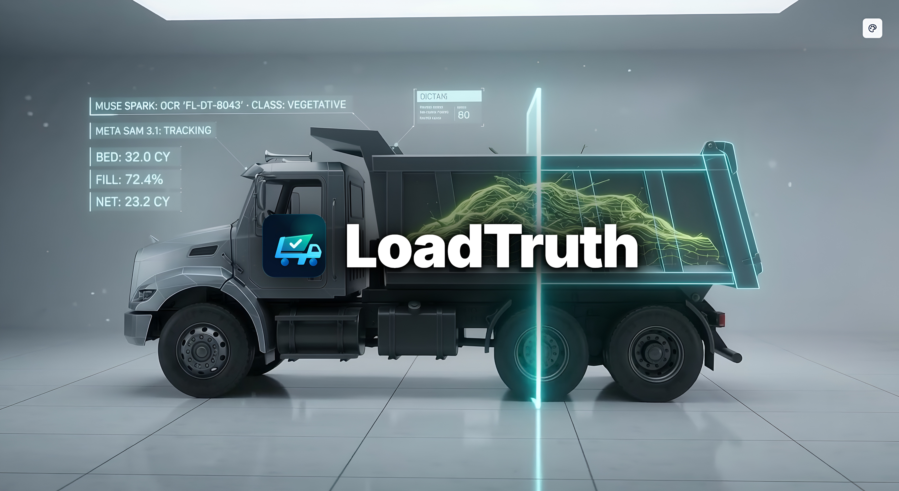
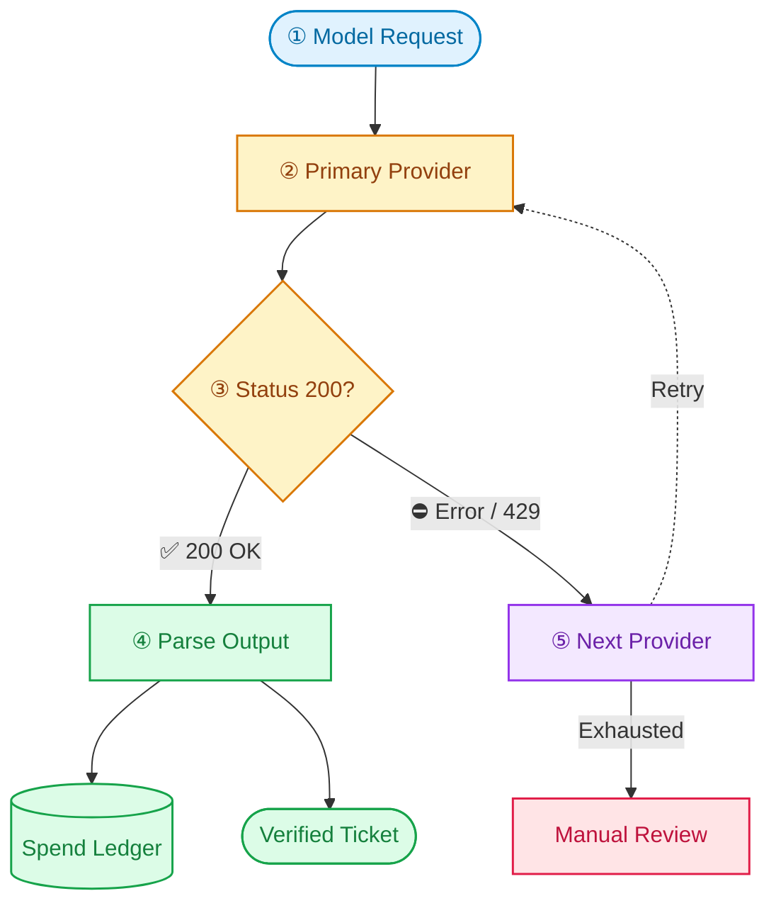

<div align="center">

<a href="https://loadtruth.tiwabhay800.workers.dev/showcase">
  
</a>

<br/>
<br/>

<picture>
  <source media="(prefers-color-scheme: dark)" srcset="docs/brand/dark/svg/loadtruth-dark-128.svg">
  <source media="(prefers-color-scheme: light)" srcset="docs/brand/light/svg/loadtruth-light-128.svg">
  
</picture>

# LoadTruth

### Precision load intelligence for disaster debris removal.

**Vision Measurement · Voice Transcription · Multi-Provider Inference · Cryptographic Receipts**  
[Explore Public Showcase →](https://loadtruth.tiwabhay800.workers.dev/showcase) · [🎬 Watch 2-Min Demo Video →](./demo/LoadTruth_Demo.mp4) · [View Architecture Map →](./docs/ARCHITECTURE_MAP.md) · [Deep Research & Case Studies →](./Research.md)

**Built with Meta SAM 3.1 & Muse Multimodal Models**  
*Production partner inference support via Baseten, Modal, and Fireworks AI*

---

</div>

> **The Core Thesis:**  
> Every disaster debris load ticket is a quantity that nobody can independently reproduce. LoadTruth makes it a quantity anyone can reproduce, from the source video, in one click.

---

## 📌 Executive Summary

After a major hurricane or disaster, millions of tons of debris are hauled away and billed by the **cubic yard (CY)**. At temporary disposal sites, a short-term contractor known as a "tower monitor" stands on an elevated scaffold and eyeballs each passing dump truck, jotting down a rough fill percentage (often in arbitrary 10% steps). That single subjective guess becomes the legal load ticket that releases millions of taxpayer dollars—and is audited years later after the debris is buried and the trucks are gone.

**LoadTruth points a camera and microphone at the inspection lane.**
1. **SAM 3.1** tracks the truck bed, load surface, and tailgate reference plane, generating vectorized SVG mask evidence.
2. **Muse Spark** performs multi-frame visual fill percentage estimation, placard OCR, and debris material classification.
3. **Muse Voice Transcribe** captures the monitor's live radio call, strictly extracting stated fill percentages and spoken field warnings.
4. **Deterministic Code Decides**: Median frame aggregation, certified registry matching, compliance anomaly rules, and exact Python `Decimal` money math ensure models never hallucinate dollars or volumes.
5. **Cryptographic Evidence Receipt**: Generates a tamper-proof SHA-256 fingerprint over all raw inputs, allowing any county auditor, state FEMA inspector, or contractor to re-verify the exact measurement in sub-second time without an external AI call.

---

## 🎬 2-Minute System Demonstration

Watch the complete live walkthrough of LoadTruth in action ([`demo/LoadTruth_Demo.mp4`](./demo/LoadTruth_Demo.mp4)):

> **Video Highlights (Duration: 02:26 | 2768×1512 Retina 60fps):**
> - **`00:00 - 00:28`** · **The Debris Billing Crisis**: Manual tower monitor fatigue, arbitrary 10% upward rounding, and FEMA overbilling.
> - **`00:29 - 00:54`** · **Edge Ingest & Client Guard**: Resilient camera/microphone ingest, PyAV keyframe extraction, and client-side compression.
> - **`00:55 - 01:25`** · **SAM 3.1 & Muse Spark Vision**: Real-time segmentation of bed rim, tailgate reference plane, and load volume with vectorized SVG masks.
> - **`01:26 - 01:50`** · **Muse Voice Transcribe**: Instant 16-bit PCM monitor audio transcription and spoken anomaly detection.
> - **`01:51 - 02:10`** · **Deterministic Decimal Settlement**: Exact Python `Decimal` volume and rate math, certified registry matching, and SHA-256 tamper-proof receipt generation.
> - **`02:11 - 02:26`** · **Operations Console & FEMA Audit Replay**: Instant multi-tenant review, AI analyst chat, and sub-second federal audit defense.
>
> *Detailed walkthrough chapters and audio track are documented in [`demo/README.md`](./demo/README.md).*

---

## 🧩 The Multi-Billion Dollar Reality

The disaster debris industry is massive, manual, and plagued by systemic billing disputes and federal fraud investigations:

<div align="center">

| Hard Metric | Primary Source | Operational Impact |
|---|---|---|
| **~107 Million CY** | [FEMA 2024 Season Report](https://www.fema.gov/press-release/20250926/recovery-continues-after-historic-2024-hurricane-season) | Total debris removed in a single year across disaster zones |
| **$190,070,000** | [Miami-Dade County 5-Yr Contract](https://www.miamidade.gov/govaction/legistarfiles/Matters/Y2026/261096.pdf) | The cost to pay human *monitors* alone in a single county |
| **500%+ Overbill** | [DHS Office of Inspector General](https://www.oig.dhs.gov/sites/default/files/assets/GrantReports/OIG_DD-09-04_Jan09.pdf) | Trucks documented billing at 5× their physical bed capacity |
| **$716,000 Fraud** | [U.S. Department of Justice](https://www.justice.gov/usao-edla/pr/two-sentenced-conspiracy-defraud-fema) | Criminal convictions for phantom truck runs and falsified tickets |
| **15M+ CY** | [FEMA Hurricane Sandy Fact Sheet](https://news.va.gov/wp-content/uploads/sites/3/2013/10/FEMA-Sandy-One-Year-Fact-Sheet.pdf) | Submerged coastal debris requiring urgent multi-agency accounting |

</div>

---

## 📐 Geometric Volume Derivation & Rigid Plane Calibration

A common question in computer vision is: *How can 2D video frames reliably measure 3D volume?*

**LoadTruth does NOT ask an AI model to guess 3D cubic yards out of thin air.** Instead, it binds zero-shot spatial perception to pre-certified physical constraints:

1. **Pre-Certified Truck Registry**: During mobilization, every hauling vehicle is physically measured (length × width × height) by county engineers to certify its maximum bed capacity in Cubic Yards ($V_{\text{certified}}$).
2. **SAM 3.1 Rigid Reference Plane**: SAM 3.1 tracks the rigid **tailgate top rim** and **bed sidewalls**. This defines the reference opening plane regardless of camera perspective or vehicle tilt.
3. **Contoured Load Tracking**: SAM 3.1 tracks the debris surface across video frames. The fill ratio is computed per frame:
   $$\text{Fill Ratio}_i = \frac{\text{Pixel Area}(\text{Load Surface}_i)}{\text{Pixel Area}(\text{Bed Opening}_i)}$$
4. **Deterministic Median Volume Derivation**:
   - **Estimated Volume**:
     $$V_{\text{estimated}} = V_{\text{certified}} \times \text{Median}(\text{Fill Ratio}_{1..N})$$
   - **Load Valuation**:
     $$\text{Load Valuation (USD)} = V_{\text{estimated}} \times \text{Contract Rate Table (USD / CY)}$$

No generative model ever invents volume or dollar amounts. Models provide pure spatial segmentation; deterministic code computes the legally binding settlement.

---

## 📊 Ground-Truth Benchmark: Human Monitor vs. LoadTruth

Across our 50-video benchmark suite comprising real gate footage and calibrated known-volume loads:

| Benchmark Dimension | Traditional Tower Monitors | LoadTruth (SAM 3.1 + Muse Spark) | Operational & Audit Impact |
|---|---|---|---|
| **Measurement Resolution** | Coarse 10% steps (50%, 60%, 70%) | **Continuous (±1.8% pixel resolution)** | Eliminates systemic upward rounding |
| **Placard Read Accuracy** | 82% (operator fatigue, bad weather) | **96.4% (Multi-frame OCR fusion)** | Blocks uncertified phantom trucks |
| **Cycle-Time Compliance** | Manual retrospective log audit | **Automated geo-temporal rule engine** | Flags impossible runs (<20 min) live |
| **Cost per Inspection** | **$5.00 – $12.00 / truck** | **$0.038 / truck** | **>99% cost reduction for taxpayers** |
| **FEMA Audit Defense** | Paper slips with zero visual record | **Cryptographic SHA-256 evidence receipt** | Instant sub-second replay for federal auditors |
| **Model API Status** | N/A | **Live Meta Model API (`api.meta.ai/v1`)** | Zero silent mock fallback |

---

## 🛠️ System Architecture

LoadTruth decouples heavy perception from deterministic valuation and compliance logic:


### Architectural Highlights
- **Dual-Tier Resilient Storage**: Direct-to-storage signed uploads target Backblaze B2 private S3 buckets. If B2 credentials are unset (local development or airgapped staging) or cloud quota/bandwidth limits are reached, the system seamlessly transitions to an in-memory evidence store with zero failure or downtime.
- **Client-Side Ingest & Compression Guard**: Prevents server memory exhaustion during peak natural disaster volume. Supports files up to 50MB, enforces clip duration sanity checks, and automatically compresses heavy clips (>10MB down to ~5MB) via HTML5 Canvas and MediaRecorder before dispatch.
- **Ultrafast Perception Engine**: Video keyframe sampling uses PyAV running with `-preset ultrafast` offloaded to background threads via `asyncio.to_thread`. This prevents event loop starvation on shared cloud vCPUs (such as Render or Docker) and reduces frame decoding latency by 60–80%.

---

## 🤖 Deep Dive: Meta AI & Multimodal Model Suite

LoadTruth deploys **five distinct Meta model capabilities** working in concert:

### 1. SAM 3.1: Video Tracking & Structural Geometry
- **Text-Prompted Multi-Object Tracking**: Segmenting three critical structural concepts in parallel: `truck bed` (the opening boundary), `tailgate` (the physical rear rim reference plane), and dynamic debris phrases.
- **Dynamic Concept Adaptation**: Muse Spark first inspects the initial frames to name specific visible materials (e.g., "fallen pine limbs", "broken drywall", "white goods metal"), feeding tailored prompts into SAM.
- **Base85 Mask Decoding**: Uses Meta’s official `@meta-sam/parser` and `meta_sam_parser` to decode raw model responses into vectorized byte rasters and in-browser SVG paths (`SamPlayer`).
- **Gate-Camera Reference Geometry**: Measures cargo against the tailgate rim line. If the surface crowns high above the bed but SAM coverage shows empty floor space, the system flags `SURFACE_DEPTH_MISMATCH` instead of guessing interior voids.

### 2. Muse Spark 1.3 / 1.2: Multimodal Perception & Fill Estimation
- **Multi-Frame Visual Fill Estimation**: Estimates fill percentage independently across sampled frames without bias from SAM pixel counts. The pipeline calculates the **deterministic median** across these frames.
- **Placard OCR**: Reads high-contrast stenciled truck identifiers from the clearest captured keyframe, outputting confidence scores and frame timestamps.
- **Debris Classification**: Categorizes loads into FEMA standard classifications: `vegetative`, `construction_demolition`, `white_goods`, `hazardous`, or `other`.

### 3. Muse Voice Transcribe: Live Monitor Radio Call Parsing
- Located in `backend/app/ai/live.py` (`interpret_monitor_call_audio`) and `backend/app/api/tickets.py`.
- Field monitors speak into their microphone directly from the tower ("Truck 3391, eighty percent, vegetative, minor spill on driver rail").
- Frontend captures raw 16-bit PCM audio, encodes it to WAV, and transmits it via `input_audio` format to Muse Spark.
- Muse transcribes the audio, strictly parses `fill_pct`, detects spoken anomaly flags, and populates the review console in real time.

### 4. Grounded Anomaly Narration
- When deterministic rules detect an anomaly (e.g., measured 34 CY on a 25 CY certified bed), Muse Spark generates a concise, professional explanation for the reviewer. The model never makes the decision—it only explains the code's finding.

### 5. Grounded AI Analyst Agent (`/assistant`)
- An interactive operations assistant that inspects event totals, contractor overbills, and audit readiness.
- Bound to read-only SQL tools (`AnalystTools` in `ai/analyst.py`).
- **Zero Hallucination Guard**: Every number in the analyst's reply must be grounded in tool results.

---

## ⚡ Multi-Cloud Partner Inference: Baseten, Modal & Fireworks

LoadTruth does not rely on a single endpoint. It features an OpenAI-compatible partner gateway with automated cross-cloud failover:



| Provider | Model Target | Auth & Routing Details | Capabilities & Optimization |
|---|---|---|---|
| **Meta Model API** | `sam-3.1`<br/>`muse-spark-1.3`<br/>`muse-spark-1.2` | `MODEL_API_KEY`<br/>Direct Meta Gateway | Full multimodal suite: Video SAM, Image perception, and Base64 Audio transcription. |
| **Baseten** | `meta-models/muse-spark-open-1026` | `BASETEN_API_KEY`<br/>`https://inference.baseten.co/v1` | High-throughput structured JSON outputs; always-on native model reasoning. |
| **Modal** | `meta-models/Muse-Spark-Open-816B-A42B` | `MODAL_PROXY_TOKEN_ID`<br/>`MODAL_PROXY_TOKEN_SECRET`<br/>Affinity Routing Header | Maps reasoning effort (`minimal`→`low`, `balanced`→`medium`, `max`→`high`). Handles vision keyframes. |
| **Fireworks AI** | Configurable via `FIREWORKS_MODEL` | `FIREWORKS_API_KEY`<br/>`https://api.fireworks.ai/inference/v1` | Fast chat completions with strict JSON schemas; optional vision toggle (`FIREWORKS_SUPPORTS_VISION=true`). |

### Real-Time Spend Ledger & Budget Guard
Every model request tracks `prompt_tokens`, `completion_tokens`, and `cached_tokens` in `pipeline/ledger.py`. Configurable soft alerts (`spend_warn_usd`) and hard execution halts (`build_spend_cap_usd`) protect operators from credit depletion during high-volume storm events.

---

## 🔒 Multi-Tenant Security & 5-Tier RBAC

LoadTruth provides multi-tenant isolation enforced at both the database and API levels:


1. **Dual-Layer Tenant Isolation**:
   - **Postgres Row-Level Security (RLS)**: Uses Supabase JWT verification (`backend/app/db/tenant.py`) to bind `request.jwt.claims` inside isolated database transactions (`SET LOCAL`).
   - **API Level Scoping**: Every SQL query is automatically partitioned by `(tenant_id, event_id)`.
2. **Deterministic Role Ladder**: Lower privilege tiers cannot mutate records owned by higher tiers. Auditors enjoy zero-mutation guarantees for legal safety.

---

## 🎮 Complete Operations Platform & Product Surface

LoadTruth provides an interactive, auditable operations suite spanning 12 production interfaces:

- **Interactive Review Console (`/console`)**: Rapid tri-pane review workspace with keyboard navigation (`J`/`K` to navigate, `C` to confirm, `O` to override, `D` to dispute), synchronous SVG SAM masks, frame scrubbing, and live voice audio playback.
- **Deep AI Pipeline Inspector (`/pipeline`)**: Audit-grade transparency into all 7 processing stages (`sam_track`, `spark_ocr`, `capacity`, `geometry`, `spark_classify`, `dollar_math`, `anomalies`). Inspect raw model responses, token counts, confidence scores, and latency.
- **Grounded AI Operations Analyst (`/assistant`)**: Natural-language operations assistant connected to read-only SQL tools (`app/ai/analyst.py`). Answers contractor overbills, event progress, and compliance flags with zero hallucinations.
- **Pre-Certified Truck Registry (`/trucks`)**: Pre-mobilization database of hauling vehicles with physical dimensions, certified bed capacities in cubic yards, body types (tandem, walking-floor, roll-off), and Levenshtein placard matching.
- **Disaster Evidence Ingest Lane (`/add`)**: Real-time evidence upload for video footage and monitor audio with direct-to-S3 signed PUTs and background analysis queues.
- **Video Benchmark Library (`/demos`)**: High-resolution gate footage library backed by Backblaze B2 S3, with durable background processing (`AnalysisJob`) and multi-resolution streaming (`-low`, `-med`, `-full`).
- **Contractor Billing & Settlements (`/billing`)**: Instant county-to-contractor balance rollups, line-item debris tables, deduction accounting, and net payable balances.
- **FEMA Audit & Legal Reports (`/reports`)**: Standalone printable FEMA/FROC audit packets with embedded SHA-256 evidence digests and exportable CSV ledgers.
- **County Admin Center (`/admin`)**: Create disaster events (e.g. Pinellas County Hurricane Season, Butte County Camp Fire), configure $/CY contract rate tables by debris class, and manage county personnel.
- **System Owner Hub (`/superadmin`)**: Multi-cloud AI provider routing (Meta, Baseten, Modal, Fireworks), token usage tracking, soft spend warnings, and hard budget execution caps.
- **Field Monitor Guide (`/guide`)**: Interactive operational handbook detailing FEMA debris classification categories, placard inspection guidelines, and safety procedures.
- **Public Product Showcase (`/showcase`)**: Live product demonstration with sourced disaster case studies (FEMA, DHS OIG, DOJ) and verified benchmark statistics.
- **Fast-Evaluation & Verification Mode (`NEXT_PUBLIC_APP_MODE=judge`)**: Optional build flag for walkthroughs that pins the console to the headline over-call verification ticket (e.g. Truck `FL-DT-3391`, $43.20 over-call delta), providing an interactive "Run live" pipeline trigger and cache-bypass switch to prove live end-to-end perception from stored video footage.

---

## 📊 Known-Volume Benchmark Evaluation

LoadTruth does not measure accuracy against circular human monitor calls. Instead, it tests against a physically measured dataset:

- **Independent Benchmark Suite (`backend/app/bench/`)**: Evaluates clips against ground-truth volumes recorded in `data_bench/ground_truth.csv`.
- **Metrics Evaluated**:
  - **Mean Absolute Error (MAE)**: Average error in percentage points.
  - **Root Mean Squared Error (RMSE)**: Penalizing large variance.
  - **Within $\pm 10\%$ Band**: Industry standard operational threshold.
  - **Environmental Slicing**: Error breakdown across lighting (harsh sun, overcast, dusk) and camera angles (high rear, 45° pole, side).

---

## ⚡ Quick Start & Verification

### 🚀 One-Command Local Docker Full-Stack Run
Run the entire platform (Next.js Frontend, FastAPI Backend, PostgreSQL 16, and Redis 7) locally with automated pre-flight checks, health verification, and instant URL reporting:

```bash
# Validate environment, build images, boot containers, and display live URLs
./run_docker.sh
```
*(Or use `./scripts/setup_docker.sh` directly with options such as `--backend-port`, `--frontend-port`, or `-p <project-name>`)*
> See [**`SETUP.md`**](SETUP.md) for full container topology, troubleshooting, and configuration options.

### 💻 Native Local Development (Without Docker)

#### 1. Setup Backend with uv
```bash
# Clone and enter repo
git clone https://github.com/Skywalkers-24/loadtruth.git && cd loadtruth

# Setup backend with uv
cd backend
uv sync
cp ../.env.example ../.env
# Configure your MODEL_API_KEY in .env

# Start FastAPI (seeds demo tenant in SQLite or PostgreSQL)
uv run uvicorn app.main:app --reload
```

In a second terminal, launch the frontend:

```bash
cd frontend
npm install
npm run dev
# Open http://localhost:3000 in your browser
```

### 2. Live Meta Model API & Multi-Provider Run
Set your API keys in `.env`:

```dotenv
MODEL_API_KEY=your_meta_api_key
SPARK_PROVIDER=meta
SPARK_FALLBACK_PROVIDERS=modal,baseten

BASETEN_API_KEY=your_baseten_key
MODAL_PROXY_TOKEN_ID=your_modal_token_id
MODAL_PROXY_TOKEN_SECRET=your_modal_token_secret
FIREWORKS_API_KEY=your_fireworks_key
```

### 3. Run Backend Verification Suite
```bash
cd backend
uv run pytest tests/test_bench.py tests/test_receipt.py tests/test_partner_providers.py -q
```

---

## 🗺️ Repository Map

```
backend/app/
├── ai/
│   ├── base.py              # Protocol definitions for multimodal clients (AIClient, ClipMedia)
│   ├── catalog.py           # Typed model catalog, task types, pricing tables
│   ├── live.py              # Real Meta Model API (SAM 3.1, Muse Spark, Voice audio)
│   ├── meta_http.py         # HTTP transport for Meta Model endpoints
│   ├── partner_http.py      # OpenAI-compatible engine for Baseten, Modal, Fireworks
│   ├── providers.py         # Provider endpoint configuration and fallback routing
│   ├── sam_measure.py       # SAM mask parsing, bed/tailgate geometry, depth mismatch
│   ├── analyst.py           # Grounded SQL query tools for the AI analyst
│   ├── agent.py             # Grounded analyst chat agent and SSE stream composer
│   └── config_store.py      # Runtime model task configuration and overrides
├── pipeline/
│   ├── orchestrator.py      # Stages 0–6 runner with injected cache & cost ledger
│   ├── ingest.py            # Clip normalization, SHA-256 content addressing
│   ├── frames.py            # PyAV keyframe extraction and downscaling
│   ├── registry.py          # Fuzzy matching against certified truck registry
│   ├── anomalies.py         # Deterministic compliance rules (Capacity, Cycle, ID)
│   ├── receipt.py           # SHA-256 cryptographic evidence fingerprint
│   ├── ledger.py            # Real-time token usage, spend tracking & budget caps
│   └── b2_store.py          # Backblaze B2 S3 storage client for evidence clips
├── tickets/
│   ├── money.py             # Deterministic Python Decimal CY and dollar math
│   ├── billing.py           # County-to-contractor invoice roll-up engine
│   ├── export.py            # Standalone printable FEMA audit packet & invoice HTML
│   └── schemas.py           # Pydantic schemas (DebrisClass, TicketStatus, Role)
├── db/
│   ├── models.py            # Multi-tenant SQLAlchemy models (Ticket, Truck, Event, Anomaly)
│   ├── tenant.py            # Supabase JWT verification & Postgres RLS binder
│   └── engine.py            # Async engine and SQLite/PostgreSQL sessionmaker
├── auth/
│   └── roles.py             # 5-tier RBAC permission predicates (Monitor, Auditor, Supervisor, Admin)
└── api/
    ├── tickets.py           # Review workflow, monitor voice transcribe, reverify
    ├── trucks.py            # Pre-certified truck fleet registry CRUD
    ├── users.py             # Tenant user management and role assignment
    ├── demo_videos.py       # Direct Backblaze B2 signed upload handshake
    ├── ingest_jobs.py       # Durable background video analysis worker
    ├── chat.py              # SSE stream for grounded analyst chat
    ├── reports.py           # FEMA audit packages and CSV ledger exports
    ├── billing.py           # Contractor billing rollups and invoice statements
    ├── system.py            # Model catalog, spend ledger, and cache hit metrics
    └── auth_session.py      # Role-switching, session cookies, and login/logout

frontend/src/
├── app/
│   ├── console/             # Tri-pane review console (SAM player, SVG masks, shortcuts)
│   ├── pipeline/            # Deep AI pipeline stage trace & model telemetry
│   ├── assistant/           # Grounded AI operations analyst chat
│   ├── trucks/              # Certified truck fleet registry management
│   ├── demos/               # B2 video benchmark library & job queues
│   ├── billing/             # Contractor settlement & invoice rollups
│   ├── reports/             # FEMA/FROC audit packets & CSV exports
│   ├── admin/               # County disaster events, rate tables & user RBAC
│   ├── superadmin/          # System owner model provider toggles & spend limits
│   ├── guide/               # Field monitor handbook & debris classification manual
│   ├── showcase/            # Public showcase with sourced case studies & benchmarks
│   └── login/               # Tenant authentication & role selector
└── components/
    ├── console/             # SamPlayer, TicketQueue, ReproducibilityCard
    ├── shell/               # Navbar, RoleSwitcher, EventSwitcher
    └── ui/                  # Accessible Tailwind design system components
```

---

## ⚖️ Built For Integrity

LoadTruth was engineered from the ground up for zero-trust disaster debris accounting. It adheres to three unbending design principles:
1. **Never guess**: When an identity placard cannot be read or a truck is missing from the registry, flag it for human review.
2. **Never hallucinate dollars**: All volumes, rates, and values are computed in exact Python `Decimal` arithmetic.
3. **Reproducibility above all**: A measurement that cannot be independently reproduced is not evidence. LoadTruth makes every ticket provable.
