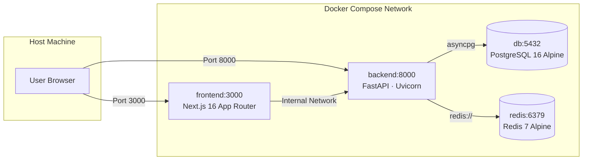

# LoadTruth — Local Docker Setup & Deployment Guide

This guide walks through running the entire **LoadTruth** full-stack platform locally inside Docker containers with a single automated script.

---

## ⚡ Quick Start (One Command)

To run the complete automated pre-flight validation, build all images, start containers, and display live URLs, run:

```bash
./scripts/setup_docker.sh
```

---

## 🛠️ Automated Validation Performed by `setup_docker.sh`

The setup script [`scripts/setup_docker.sh`](./scripts/setup_docker.sh) handles the entire local deployment lifecycle safely and idempotently:

1. **Docker Engine & Daemon Check**:
   - Confirms `docker` is installed and the daemon is active and responsive.
   - Detects whether to use `docker compose` (v2 plugin) or standalone `docker-compose`.
2. **Environment File Initialization & Validation**:
   - Checks for `.env`. If absent, automatically copies `.env.example` to `.env`.
   - **Zero-Credit Safeguard**: If `MODEL_API_KEY` is empty or set to placeholder, the script automatically sets `MOCK_AI=1` in `.env`. This ensures the stack boots **100% offline with zero external API calls at $0 cost**.
   - Ensures local volume directories (`logs/`, `media/evidence/`) exist on the host.
3. **Port Availability Verification**:
   - Probes host ports **3000** (Frontend), **8000** (Backend API), **5432** (PostgreSQL), and **6379** (Redis).
   - Differentiates between existing Docker-managed containers and third-party conflicting host processes.
4. **Container Build & Background Startup**:
   - Runs `docker compose up -d --build` to compile both backend and frontend images.
5. **Healthcheck & Readiness Polling**:
   - Polls PostgreSQL (`pg_isready`) and Redis (`redis-cli ping`) until healthy.
   - Probes the FastAPI backend (`http://localhost:8000/health`) and Next.js frontend (`http://localhost:3000`) until both respond with HTTP 200.
6. **Live URL Dashboard**:
   - Displays all active web endpoints, review screens, documentation links, and operational management commands.

---

## 🔑 Administrator & Member Authentication

LoadTruth provides two authentication portals:

### 1. Developer & SuperAdmin Portal (`/superadmin`)
For system administration, changing per-task AI models, and uploading demo benchmark clips:
* **URL:** [http://localhost:3000/superadmin](http://localhost:3000/superadmin)
* **Username:** `admin`
* **Password:** `LoadTruthAdmin!`

*(Configured via `SUPERADMIN_USERNAME` and `SUPERADMIN_PASSWORD` in `.env`).*

### 2. Standard Operations & Reviewer Directory (`/login`)
For operational field roles:
* **URL:** [http://localhost:3000/login](http://localhost:3000/login)
* **One-Click Directory Sign-in:** Switch instantly between pre-configured operational roles:
  * **County Admin** (`admin@pinellas.gov`): Manage events, set rate tables, manage members.
  * **Supervisor** (`operator@gulfresponse.org`): Manage truck fleet certifications and evidence sources.
  * **Field Monitor** (`monitor1@gulfresponse.org`): Adjudicate tickets, record audio radio calls.
  * **State Auditor** (`auditor@state.fl.us`): Read-only FEMA audit packet and CSV exports.

---

## ☁️ Running With vs. Without Backblaze B2

> **Key Architecture Fact:**  
> **LoadTruth's real AI vision & measurement pipeline (Meta SAM 3.1 + Muse Spark) runs completely without Backblaze B2.**

| Storage Mode | B2 in `.env` | How AI Ingestion Works | Use Case |
|---|---|---|---|
| **In-Memory / Practice Mode** | *Omitted / Empty* | Real AI models process clip bytes directly in memory. PyAV samples keyframes, SAM 3.1 segments masks, and Muse Spark estimates fill %. Footage is retained in bounded transient memory (`keep_footage=false`). | Local evaluation, zero-cloud setup, air-gapped demo runs. |
| **Persistent B2 Cloud Storage** | `B2_KEY_ID`, `B2_APPLICATION_KEY`, `B2_BUCKET_NAME`, `B2_S3_ENDPOINT`, `B2_REGION` | Browser uploads clips directly to private B2 S3 via presigned PUT URLs with CORS preflight. Video versions are pinned in PostgreSQL for multi-year FEMA auditability. | Production county deployments, multi-tower fleets, multi-user cloud reviews. |

---

## ⚡ Disaster Events: Seeded & Dynamic Provisioning

Disaster events scope all rate tables, truck registries, and tickets:

1. **Automatic Default Seed:**  
   On startup, the database automatically seeds **"Hurricane Season 2026"** (Pinellas County, FL) with 15 certified trucks, sample tickets across all anomaly categories, and pre-computed reproducibility receipts.
2. **Automated Dynamic Provisioning:**  
   Every time [`./scripts/setup_docker.sh`](./scripts/setup_docker.sh) executes, it authenticates as SuperAdmin and dynamically calls `POST /events` on the backend, generating a fresh, timestamped disaster event (e.g., *"Emergency Debris Operation 2026-11-01"*) with configured debris rates ($8/CY vegetative, $12/CY C&D, $15/CY white goods, $25/CY hazardous).

---

## 🐳 Container Topology & Ports



| Service | Container Image | Host Port | Internal Port | Purpose |
|---|---|---|---|---|
| **frontend** | `node:22-slim` (Next.js 16 standalone) | `3000` | `3000` | Review console, public showcase, video library, billing |
| **backend** | `python:3.12-slim` (FastAPI + ffmpeg) | `8000` | `8000` | 7-stage pipeline, AI client seam, REST & SSE APIs |
| **db** | `postgres:16-alpine` | `5432` | `5432` | Tenanted tickets, users, analysis jobs, traces, and stage cache |
| **redis** | `redis:7-alpine` | `6379` | `6379` | Background task queue & cache seam |

---

## 🎯 Operating Modes

You can toggle LoadTruth's operational mode inside `.env`:

### Mode 1: Zero-Credit Mock Mode ($0 Cost, Offline)
* **Configuration:** `MOCK_AI=1`
* **Behavior:** All SAM 3.1 segmentation, Muse Spark fill estimation, OCR, debris classification, and analyst tools resolve from deterministic recorded fixtures in `backend/app/ai/fixtures/scenarios.json`.
* **Ideal For:** Fast local evaluations, offline judge walkthroughs, unit/integration testing without internet or API keys.

### Mode 2: Live Meta & Multi-Cloud Partner Mode
* **Configuration:**
  ```dotenv
  MOCK_AI=0
  MODEL_API_KEY=your_meta_api_key
  SPARK_PROVIDER=meta
  SPARK_FALLBACK_PROVIDERS=modal,baseten
  BASETEN_API_KEY=your_baseten_key
  MODAL_PROXY_TOKEN_ID=your_modal_token_id
  MODAL_PROXY_TOKEN_SECRET=your_modal_token_secret
  ```
* **Behavior:** Ingested tower videos run through live Meta SAM 3.1 segmentation and Muse Spark models, with automatic failover to Modal or Baseten if transient rate limits occur.

### Mode 3: Judge Demo Mode
* **Configuration:**
  ```dotenv
  NEXT_PUBLIC_APP_MODE=judge
  ```
* **Behavior:** The operator review console (`/console`) boots immediately into the headline over-call demo ticket ($43.20 delta), offering a "Run live" button and a cache-bypass switch to prove live end-to-end execution.
* Rebuild frontend after editing build args:
  ```bash
  docker compose build frontend && docker compose up -d frontend
  ```

---

## 🌐 Live URLs

Once started, access the following endpoints:

| Interface | URL | Description |
|---|---|---|
| **Operator Console** | [http://localhost:3000](http://localhost:3000) | Root application landing |
| **Public Showcase** | [http://localhost:3000/showcase](http://localhost:3000/showcase) | Zero-login overview, story & FEMA case studies |
| **Ticket Review Workspace** | [http://localhost:3000/console](http://localhost:3000/console) | Single-screen review, SAM SVG masks, reverify receipt |
| **Demo Video Library** | [http://localhost:3000/demos](http://localhost:3000/demos) | S3/B2 clip library, side-by-side mask comparisons |
| **Pipeline Jobs & Traces** | [http://localhost:3000/pipeline](http://localhost:3000/pipeline) | Live SSE stage trace and per-stage model breakdown |
| **Invoicing & Billing** | [http://localhost:3000/billing](http://localhost:3000/billing) | County-to-contractor rollups, printable FEMA packets |
| **AI Analyst Assistant** | [http://localhost:3000/assistant](http://localhost:3000/assistant) | Grounded natural language Q&A over tenant data |
| **Backend Health** | [http://localhost:8000/health](http://localhost:8000/health) | API health check & Model API status |
| **Interactive OpenAPI Docs** | [http://localhost:8000/docs](http://localhost:8000/docs) | Swagger UI for exploring all backend routes |

---

## 📋 Common Management Commands

```bash
# View aggregated live logs across all containers
docker compose logs -f

# View live logs for a specific service
docker compose logs -f backend
docker compose logs -f frontend

# Check container status and health
docker compose ps

# Stop all containers (preserving data volume)
docker compose down

# Stop all containers and wipe database volume (clean slate reset)
docker compose down -v

# Re-run full setup and health check
./scripts/setup_docker.sh
```

---

## ❓ Troubleshooting

### 1. "Docker daemon is not running"
* Ensure Docker Desktop is launched on your system. Wait until Docker Desktop displays "Engine running" and retry `./scripts/setup_docker.sh`.

### 2. "Port 3000 or 8000 already in use"
* Check which process occupies the port:
  ```bash
  lsof -i :3000
  lsof -i :8000
  ```
* Terminate any lingering local node or uvicorn processes before running Docker.

### 3. Resetting the Local Database
* If you want to wipe the local database and re-seed the default tenant and tickets:
  ```bash
  docker compose down -v
  ./scripts/setup_docker.sh
  ```

